<!-- Every card is an animated SVG drawn by scripts/render_readme_cards.py and refreshed
     daily by .github/workflows/readme-cards.yml. Spacing is baked into the SVGs, so keep
     this block free of blank lines and keep the three-card rows on one line with no
     spaces between the tags. -->

 
 
 
 
 

---

  <b>Currently building</b> agentic systems that plan, call tools and ship code — with a soft spot for
  AI-driven games and anything that points at the sky.

  

  
  
  
  

  
  
  
  

